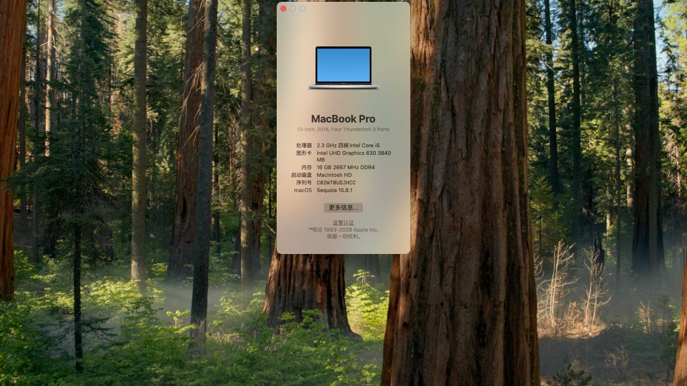

# ASUS 飞行堡垒6 (FX86FE) Hackintosh EFI

基于 OpenCore 引导的 **华硕飞行堡垒6 FX86FE** 黑苹果 EFI，已在 macOS Sequoia 15.8.1 上长期稳定使用。



> ⚠️ **上传/使用前必读**：本 EFI 中带有我的 SMBIOS 序列号等个人化信息。**使用前请务必用 [GenSMBIOS](https://github.com/corpnewt/GenSMBIOS) 重新生成** `PlatformInfo → Generic` 下的 `SystemSerialNumber` / `MLB` / `SystemUUID`（ROM 可用随机值），否则有被苹果封号风险且两台机器序列号冲突。

---

## 一、适配机型

| 项目   | 说明                                                                                                        |
| ---- | --------------------------------------------------------------------------------------------------------- |
| 实机验证 | 华硕飞行堡垒6 **FX86FE**（2018）                                                                                  |
| 理论适配 | 同模具 FX86FM/FX86FN，以及 8 代 Coffee Lake-H 标压 + UHD 630 + GTX 1050/1050Ti + Realtek 有线 + Intel 无线 的同结构机型（需微调） |
| 不适配  | 仅核显（i5-8250U 等 U 系低压）机型                                                                                   |

## 二、硬件配置

| 硬件   | 型号                                              | macOS 状态                                               |
| ---- | ----------------------------------------------- | ------------------------------------------------------ |
| CPU  | Intel Core i5-8300H（4 核 8 线程，45W，Coffee Lake-H） | ✅ 变频正常（CPUFriend 定制）                                   |
| 核显   | Intel UHD Graphics 630                          | ✅ 硬件加速（Metal 3）                                        |
| 独显   | NVIDIA GTX 1050 Ti 4GB（Pascal）                  | ❌ Sequoia 已无 Pascal 驱动，已隐藏（Windows 下正常）                |
| 内存   | 16GB DDR4 2667MHz                               | ✅                                                      |
| 硬盘   | Toshiba NVMe SSD                                | ✅                                                      |
| 无线网卡 | Intel Wireless-AC 9462                          | ✅ AirportItlwm（Wi-Fi 原生菜单）                             |
| 蓝牙   | Intel Bluetooth                                 | ✅ IntelBluetoothFirmware + BlueToolFixup               |
| 有线网卡 | Realtek RTL8111                                 | ✅                                                      |
| 声卡   | Realtek ALC 系列                                  | ✅ AppleALC                                             |
| 触控板  | I2C HID 触控板                                     | ✅ VoodooI2C + VoodooI2CHID                             |
| 键盘   | PS/2 内置键盘                                       | ✅ VoodooPS2 + BrightnessKeys + AsusSMC（Fn 功能键/背光调节全可用） |
| 电池   | SMCBatteryManager                               | ✅ 电量/健康度显示                                             |
| 屏幕   | 1920×1080 内置面板                                  | ✅ 亮度滑条 + 快捷键均可调                                        |

## 三、系统信息

- macOS **Sequoia 15.8.1**（Intel 机型最后支持的大版本）
- SMBIOS：**MacBookPro15,2**（MacBook Pro 13-inch 2018, Four Thunderbolt 3 Ports）
- 引导：OpenCore（config 已按规范精简）
- 本 EFI 基于板载真实电源表定制 CPUFriendDataProvider，参数按 **i5-8300H（45W）** 生成，而非照搬 MBP15,2 的 28W 表

## 四、主要修复与优化

### 1. 风扇满速修复（独显供电两全方案）

ASUS 笔记本风扇由 EC（嵌入式控制器）直控，**独显被 `_OFF` 断电后 EC 读不到 GPU 温度会进入保护模式，风扇直接拉满**。因此本 EFI 不采用断电屏蔽，而是：

- `SSDT-Disable_GPU_PEG0.aml` 保持 **Enabled=false**（独显持续供电，EC 可见）
- boot-args 保留 **`-wegnoegpu`**（macOS 图形栈忽略独显，不加载假显示头）

结果：风扇正常、亮度正常、系统干净。

### 2. 控制中心亮度滑条灰色修复

ASUS 的内屏连接器类型默认被核显固件报为 HDMI 类（`02000000`），导致系统把内置屏当外接屏、亮度滑条被禁用。修复：

```
framebuffer-con0-enable = 01000000
framebuffer-con0-type   = 00080000   # eDP 内屏
```

### 3. Fn 功能键 / 背光调节修复（自制 SSDT-ATKD）

ASUS 的 Fn 组合键事件由 EC 通过 ATKD（华硕 ACPI 通知接口）上报，原版 DSDT 的通知链在 macOS 下不完整，导致 **Fn+F6、Fn+F10、Fn+↑/↓ 调节背光全部失效**。修复方案：

- **SSDT-ATKD.aml（自制）**：在核显显示设备 `_SB.PCI0.GFX0.DD1F` 上挂载通知转发，将 EC 的背光事件（SKBV/SLKI）经 `ATKD.IANE` 上报给系统
- **AsusSMC.kext**：接收 ATKD 事件并映射为 macOS 功能键（风扇模式、飞行模式、触控板开关等）
- **BrightnessKeys.kext**：承接亮度调节事件
- **SSDT-ALSD.aml**：在 Darwin 下禁用假环境光传感器（ALSD `_STA=0`），防止"自动调节亮度"与手动调节互相干扰

### 4. 背光寄存器修复

- boot-args `-igfxblr` + DeviceProperties `enable-backlight-registers-fix`，修复 CFL 平台背光寄存器

### 5. DVMT 显存扩容

- `framebuffer-stolenmem 19MB / fbmem 9MB / unifiedmem 4GB`（DVMT 预分配不可改的 ASUS BIOS 通吃方案）

### 6. CPU 电源管理（按 i5-8300H 定制）

- **CPUFriend 1.3.0 + CPUFriendDataProvider**（用 CPUFriendFriend 基于本机 board-id 真实电源表生成）
- LFM 800MHz（0x08）、EPP 0x80（均衡省电）、CPUFloor 800
- 效果：空闲可降到 800MHz~1.5GHz，而不是一直顶着 3.9GHz

### 7. USB 端口定制

- USBToolBox + UTBMap（Windows 下用 UTBMap 工具定制，免重打 SSDT）

### 8. Intel 无网/蓝牙（Sequoia 方案）

- `IOSkywalkFamily + IO80211FamilyLegacy + AirportItlwm`（Wi-Fi 原生界面）
- `IntelBluetoothFirmware + BlueToolFixup + IntelBTPatcher`（蓝牙）

### 9. 其它

- `alcdelay=3000 alctcsel=1`：声卡冷启动/切换修复
- `XHCI-unsupported`：ASUS XHCI 控制器识别
- `ForgedInvariant`：CPU 型号名修正
- `RestrictEvents (revpatch=sbvmm)`：系统更新兼容

## 五、boot-args 现状

```
keepsyms=1 -igfxblr alcdelay=3000 alctcsel=1 -vi2c-force-polling -lilubetaall amfi=0x80 ipc_control_port_options=0 revpatch=sbvmm -wegnoegpu
```

## 六、安装说明

1. BIOS：**关闭 Secure Boot**；如可调，将 DVMT Pre-Allocated 设为 64M（不可调也没关系，已带内存补丁）
2. 将 `EFI` 文件夹放到安装 U 盘或硬盘 EFI 分区（FAT32）
3. **用 GenSMBIOS 重新生成三码**（重要，见顶部警告）
4. 安装后可选：用 [CPUFriendFriend](https://github.com/corpnewt/CPUFriendFriend) 重新生成适合自己 CPU 的 DataProvider
5. 亮度/多媒体快捷键若个别无效，重启一次即可（BrightnessKeys 在唤醒后偶发需重新匹配）

## 七、可选：Win/Ctrl 键互换（个人习惯）

macOS 复制粘贴是 ⌘+C/V，若想让两侧 Ctrl 键都能复制粘贴、Win 键当 Control 用：

```bash
hidutil property --set '{"UserKeyMapping":[{"HIDKeyboardModifierMappingSrc":0x7000000E0,"HIDKeyboardModifierMappingDst":0x7000000E3},{"HIDKeyboardModifierMappingSrc":0x7000000E4,"HIDKeyboardModifierMappingDst":0x7000000E7},{"HIDKeyboardModifierMappingSrc":0x7000000E3,"HIDKeyboardModifierMappingDst":0x7000000E0}]}'
```

持久化可写成 LaunchAgent（`RunAtLoad` 执行上述命令）。

## 八、已知问题

- **GTX 1050 Ti 无驱动**：macOS Sequoia 已移除 Pascal 架构驱动（Kepler 之后）。独显保持供电但被 `-wegnoegpu` 隐藏，性能由 UHD 630 承担。剪辑/轻度游戏可用，重度 3D 渲染请回 Windows。
- **风扇模式**：三档风扇（Fn+F5）由 EC 直控且跨系统记忆，macOS 不参与。若想切风扇模式，先回 Windows 切好再重启进 macOS。
- 内屏仅 eDP 输出，若 HDMI 外接出现异常可尝试在 con1/con2 上补 connector-type。

## 九、鸣谢

[OpenCorePkg (acidanthera)](https://github.com/acidanthera/OpenCorePkg) · [Lilu](https://github.com/acidanthera/Lilu) · [WhateverGreen](https://github.com/acidanthera/WhateverGreen) · [VirtualSMC](https://github.com/acidanthera/VirtualSMC) · [AppleALC](https://github.com/acidanthera/AppleALC) · [CPUFriend](https://github.com/acidanthera/CPUFriend) · [AsusSMC](https://github.com/hieplpvip/AsusSMC) · [BrightnessKeys](https://github.com/kprinssu/BrightnessKeys) · [VoodooI2C](https://github.com/VoodooI2C/VoodooI2C) · [USBToolBox](https://github.com/USBToolBox/kext) · [itlwm/AirportItlwm](https://github.com/OpenIntelWireless/itlwm) · [IntelBluetoothFirmware](https://github.com/OpenIntelWireless/IntelBluetoothFirmware) · [GenSMBIOS](https://github.com/corpnewt/GenSMBIOS) · [CPUFriendFriend](https://github.com/corpnewt/CPUFriendFriend)
